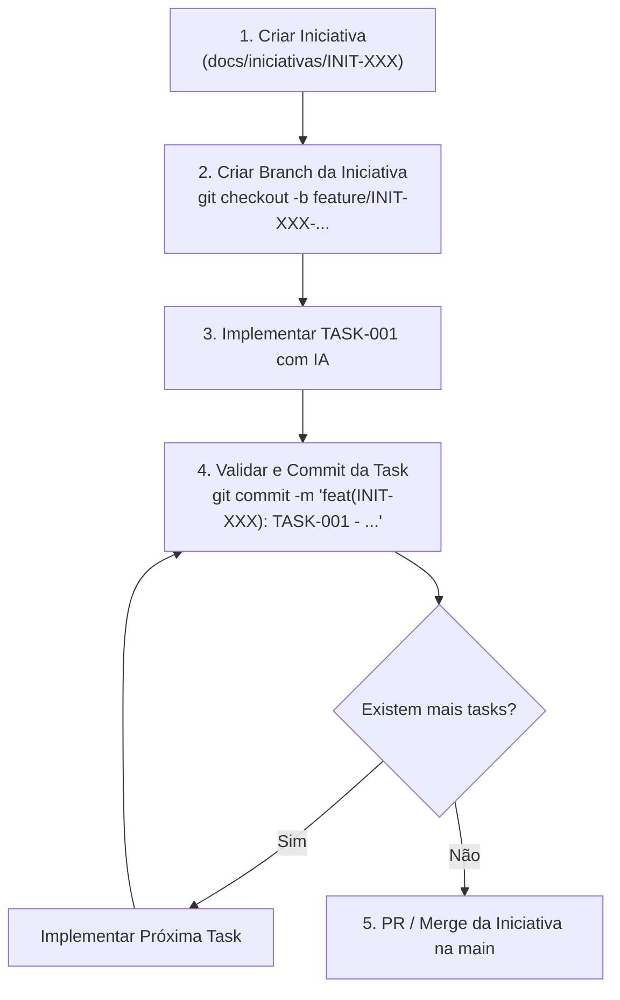

# Guia de Documentação e Spec-Driven Development (SDD)

Bem-vindo ao repositório de documentação do ecossistema **Núcleo3Pro**. Este diretório estabelece o padrão de **Spec-Driven Development (Desenvolvimento Orientado a Especificações)** do projeto.

---

## 🎯 Objetivo

1. **Contexto Onboarding & Continuidade:** Permitir que qualquer membro (desenvolvedor, designer ou gestor) compreenda rapidamente o histórico de decisões, o que já foi entregue e o que está em andamento.
2. **Desenvolvimento Acelerado por IA:** Servir de fonte de verdade rica em contexto (restrições técnicas, interfaces, casos de borda e critérios de aceite) para ferramentas de IA (Antigravity, Cursor, GitHub Copilot, Gemini, Claude).

---

## 📁 Estrutura de Pastas

```text
docs/
├── README.md                      # Este guia
├── templates/                     # Modelos prontos para copiar e preencher
│   ├── 01-INICIATIVA-TEMPLATE.md  # Visão macro (Épico / PRD de funcionalidade)
│   ├── 02-TASK-SPEC-TEMPLATE.md   # Especificação técnica executável por IA
│   └── 03-ADR-TEMPLATE.md         # Registro de Decisões de Arquitetura
├── iniciativas/                   # Iniciativas e Épicos do projeto
│   ├── README.md                  # Índice de iniciativas e roadmap
│   └── INIT-000-exemplo-.../      # Exemplo prático de iniciativa com suas tasks
└── arquitetura/                   # Decisões arquiteturais e diagramas
    ├── README.md                  # Visão geral de arquitetura e índice de ADRs
    └── adrs/                      # Architectural Decision Records
```

---

## 🔄 Fluxo de Trabalho (Workflow SDD)

O ciclo de vida de uma funcionalidade segue 5 etapas rigorosas integradas ao Git:



### 1. Criar a Iniciativa
- Copie `docs/templates/01-INICIATIVA-TEMPLATE.md` para uma nova pasta dentro de `docs/iniciativas/INIT-XXX-nome-da-iniciativa/spec.md`.
- Descreva o problema, o escopo (in/out) e o roadmap preliminar de tasks.

### 2. Criar a Branch Dedicada da Iniciativa
- **Regra:** Nunca desenvolva diretamente na branch `main`.
- Toda iniciativa possui sua própria branch:
  ```bash
  git checkout -b feature/INIT-XXX-nome-da-iniciativa
  ```

### 3. Especificar e Implementar Cada Task
- Para cada entrega técnica, copie `docs/templates/02-TASK-SPEC-TEMPLATE.md` para `docs/iniciativas/INIT-XXX-nome/tasks/TASK-YYY-nome-da-task.md`.
- No chat da IA (Antigravity, Cursor, etc.), utilize o bloco pronto **"Prompt para IA"** presente no final de cada Task Spec.
- A IA deve implementar os arquivos afetados respeitando os contratos e critérios de aceite.

### 4. Validar e Fazer Commit Atômico por Task
- **Regra:** Cada task gera **exatamente um commit atômico** logo após sua conclusão e validação.
- Marque com `[x]` os critérios de aceite concluídos no arquivo da task.
- Execute o commit exclusivo da task seguindo o padrão **Conventional Commits**:
  ```bash
  git add .
  git commit -m "feat(INIT-XXX): TASK-YYY - descrição clara do que foi implementado"
  ```

### 5. Conclusão da Iniciativa
- Quando todas as tasks da iniciativa estiverem concluídas e commitadas, abra o Pull Request ou faça o merge da branch da iniciativa para a `main`.

---

## 🌿 Diretrizes de Git para IA e Desenvolvedores

### 1. Padrão de Nomenclatura de Branches
| Tipo de Trabalho | Padrão da Branch | Exemplo Real |
| :--- | :--- | :--- |
| **Iniciativa / Feature** | `feature/INIT-XXX-nome-curto` | `feature/INIT-001-conexao-whatsapp` |
| **Melhoria Técnica** | `refactor/INIT-XXX-nome-curto` | `refactor/INIT-002-migracao-websockets` |
| **Correção Crítica** | `fix/INIT-XXX-nome-curto` | `fix/INIT-002-transbordo-disjuntor` |

### 2. Padrão Obrigatório de Mensagens de Commit
Todo commit gerado pela IA ou pelo desenvolvedor deve seguir o formato:
```text
<tipo>(INIT-XXX): TASK-YYY - <descrição imperativa no presente>
```

#### Tipos Permitidos:
- `feat`: Nova funcionalidade implementada na task.
- `fix`: Correção de bug em uma task.
- `style`: Ajustes visuais, CSS, Tailwind ou layout.
- `refactor`: Refatoração interna sem alteração de regra de negócio.
- `test`: Criação ou ajuste de testes automatizados ou mocks.
- `docs`: Atualização exclusiva de especificações ou documentação.

#### Exemplos Reais:
```bash
# Task 001 da Iniciativa 001
git commit -m "feat(INIT-001): TASK-001 - adicionar card de pareamento com qrcode e countdown"

# Task 002 da Iniciativa 001
git commit -m "feat(INIT-001): TASK-002 - implementar badge de status e dialogo de desconexao"

# Task 001 da Iniciativa 002
git commit -m "feat(INIT-002): TASK-001 - criar fila de conversas em 3 abas com badges"

# Task 002 da Iniciativa 002
git commit -m "feat(INIT-002): TASK-002 - implementar interface de mensageria com suporte a midia"
```

> [!IMPORTANT]
> **Nunca acumule alterações de múltiplas tasks em um único commit.** Cada commit deve representar a entrega exata e isolada de uma task, facilitando code reviews, auditoria e eventuais rollbacks (`git revert`).

---

## 🏷️ Convenção de Nomenclatura e Status

### Nomenclatura
- **Iniciativas:** `INIT-XXX-kebab-case` (ex: `INIT-001-integracao-whatsapp-cloud`, `INIT-002-painel-gestao-cursos`)
- **Tasks:** `TASK-YYY-kebab-case` (ex: `TASK-001-webhook-recebimento-mensagens`, `TASK-002-tabela-leads-filtros`)
- **ADRs:** `ADR-ZZZ-kebab-case` (ex: `ADR-001-escolha-shadcn-ui-tailwind`, `ADR-002-banco-vetorial-chatbot`)

### Status Padrão
| Status | Significado |
| :--- | :--- |
| `📝 Rascunho (Draft)` | Em ideação ou refinamento, ainda não pronta para execução. |
| `🔍 Em Revisão (Review)` | Pronta para alinhamento entre time técnico e produto. |
| `🚀 Aprovada / Pronta` | Especificada e pronta para início do desenvolvimento. |
| `⚙️ Em Progresso` | Sendo codificada / implementada (pelo dev ou pela IA). |
| `✅ Concluída` | Testada, validada e mergeada. |
| `⏸️ Pausada / Cancelada` | Congelada ou descartada (com justificativa documentada). |

---

## 💡 Dicas de Ouro para Trabalhar com IA

1. **Arquivos Afetados Salpicados de Precisão:** Sempre liste os caminhos reais dos arquivos na Task Spec. A IA gasta menos contexto navegando e reduz alucinações.
2. **Defina Casos de Borda (Edge Cases):** A IA costuma implementar o "caminho feliz" com facilidade. A qualidade sobe drasticamente quando você detalha erros de rede, payloads vazios, timeouts e permissões na spec.
3. **Mantenha as Tasks Pequenas:** Prefira tasks com escopo de 1 a 3 arquivos principais ou uma funcionalidade atômica. É mais rápido para a IA gerar o diff e mais seguro para você revisar.

