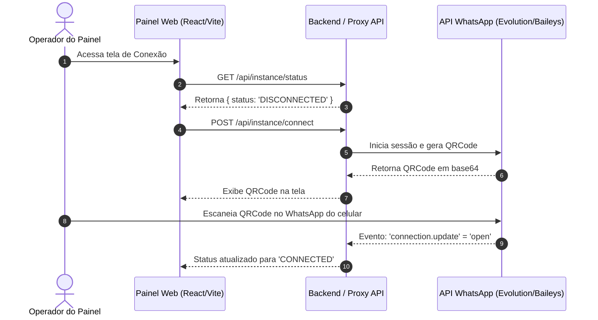

# [INIT-001] Conexão & Pareamento WhatsApp (QR Code & Status)

| Metadado | Detalhe |
| :--- | :--- |
| **ID da Iniciativa** | INIT-001 |
| **Branch Git** | `feature/INIT-001-conexao-whatsapp` |
| **Status** | 🚀 Aprovada (Pronta para Execução) |
| **Responsável / Autor** | Equipe de Produto & Engenharia Núcleo3Pro |
| **Data de Criação** | 2026-11-10 |
| **Última Atualização** | 2026-11-10 |
| **Target Release / Marco** | MVP v1.0 |

---

## 1. 🎯 Visão Geral & Problema

### 1.1 Contexto
Para que o chatbot do Núcleo3Pro e o painel administrativo operem, é necessária uma conexão ativa com o WhatsApp do negócio (utilizando APIs de mensageria como Evolution API, Z-API ou Cloud API). Quando a sessão expira ou precisa ser iniciada pela primeira vez, o operador precisa de uma interface simples para escanear o QR Code de autenticação.

### 1.2 Proposta de Valor
Disponibilizar uma tela de pareamento limpa e intuitiva no painel administrativo, exibindo o QR Code gerado em tempo real, status da conexão (Conectado / Desconectado / Reconectando) e botão de desconexão/logout da instância.

---

## 2. 📊 Objetivos & Métricas de Sucesso

- [ ] **Métrica 1:** Tempo de reconexão da instância inferior a 30 segundos pelo operador.
- [ ] **Métrica 2:** Atualização imediata do status visual da conexão sem necessidade de dar F5 (via polling ou WebSocket).
- [ ] **Métrica 3:** Redução a zero de chamadas de suporte técnico apenas para escanear QR Code do WhatsApp.

---

## 3. 👥 Personas & Casos de Uso

| Persona | Necessidade | Benefício Esperado |
| :--- | :--- | :--- |
| **Administrador / Operador** | Conectar o WhatsApp da instituição de ensino ao sistema | Processo autoexplicativo via QR Code, sem precisar de terminal ou Postman |
| **Atendente Comercial** | Saber se o canal de atendimento está online ou caiu | Indicador visual claro de status no topo ou barra lateral do painel |

---

## 4. 🧭 Escopo

### ✅ Dentro do Escopo (In-Scope)
- [ ] Tela/Modal de Configurações de Conexão (`/settings/connection` ou modal no painel).
- [ ] Exibição de QR Code atualizável (com contagem regressiva para expiração e botão de "Atualizar QR Code").
- [ ] Indicador de status da conexão: `Conectado` (verde), `Desconectado` (vermelho), `Aguardando Leitura` (amarelo).
- [ ] Ação de "Desconectar Sessão" para forçar novo pareamento se necessário.

### ❌ Fora do Escopo (Out-of-Scope para o MVP)
- Gerenciamento de múltiplas instâncias ou múltiplos números de WhatsApp simultâneos.
- Configurações avançadas de Webhooks e proxy diretamente pela UI do painel.
- Gestão de chips ou aquecimento de números.

---

## 5. 🏗️ Arquitetura de Alto Nível & Fluxos

---

## 6. 📋 Quebra de Tarefas (Task Breakdown)

| Task ID | Título da Task | Responsável | Status | Link da Spec |
| :--- | :--- | :--- | :--- | :--- |
| `TASK-001` | Interface de Pareamento com QR Code e Countdown | Dev / AI | 🚀 Pronta | [TASK-001.md](./tasks/TASK-001-tela-pareamento-qrcode.md) |
| `TASK-002` | Gerenciador de Status da Conexão e Desconexão | Dev / AI | 🚀 Pronta | [TASK-002.md](./tasks/TASK-002-status-e-desconexao.md) |

---

## 7. 🔒 Segurança, Privacidade & LGPD

- [ ] O QR Code e a chave de API da instância nunca devem ser expostos em logs públicos ou commits.
- [ ] Apenas operadores autorizados podem acessar a rota de conexão/desconexão da instância.

---

## 8. 📝 Histórico de Decisões & Mudanças

| Data | Autor | Mudança / Decisão | Motivo |
| :--- | :--- | :--- | :--- |
| 2026-11-10 | Equipe Núcleo3Pro | Criação da spec inicial para o MVP v1.0 | Setup essencial para habilitar recepção de mensagens |

