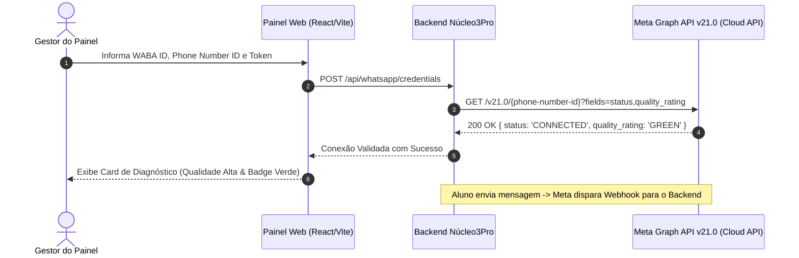

# [INIT-001] Conexão WhatsApp Business Cloud API (Meta Oficial)

| Metadado | Detalhe |
| :--- | :--- |
| **ID da Iniciativa** | INIT-001 |
| **Branch Git** | `feature/INIT-001-conexao-whatsapp` |
| **Status** | ✅ Concluída |
| **Responsável / Autor** | Equipe de Produto & Engenharia Núcleo3Pro |
| **Data de Criação** | 2026-11-10 |
| **Última Atualização** | 2026-11-11 |
| **Target Release / Marco** | MVP v1.0 |

---

## 1. 🎯 Visão Geral & Problema

### 1.1 Contexto
Para que o chatbot do Núcleo3Pro e a central de atendimento operem com estabilidade corporativa, segurança e sem risco de banimento de chips, o sistema integra diretamente com a **API Oficial do WhatsApp Business (Meta Cloud API / WhatsApp Business Platform)**. Ao contrário de soluções baseadas em WhatsApp Web / QR Code (Baileys/Evolution), a Cloud API opera através de tokens de autenticação da Graph API, Webhooks em tempo real e identificadores de conta empresarial (WABA ID e Phone Number ID).

### 1.2 Proposta de Valor
Disponibilizar uma interface administrativa moderna e intuitiva para configuração e diagnóstico da Cloud API:
- Inserção e validação de chaves oficiais (`Phone Number ID`, `WABA ID`, `Permanent Access Token` e `Webhook URL`).
- Suporte a conexão via **Embedded Signup** (Facebook Login for Business).
- Painel de saúde da linha: Indicador de qualidade da linha (`Quality Rating: GREEN`), limite de mensagens (`Messaging Tier`) e status do Webhook.
- Revogação e desconexão segura de credenciais.

---

## 2. 📊 Objetivos & Métricas de Sucesso

- [x] **Métrica 1:** Conexão direta aos servidores da Meta sem intermediários ou dependência de celular físico ligado.
- [x] **Métrica 2:** Atualização imediata do status visual da conexão e qualidade da linha no cabeçalho do painel.
- [x] **Métrica 3:** Redução a zero do risco de desconexão por falta de bateria ou queda do aparelho físico.

---

## 3. 👥 Personas & Casos de Uso

| Persona | Necessidade | Benefício Esperado |
| :--- | :--- | :--- |
| **Administrador / Gestor** | Conectar a conta comercial do WhatsApp (WABA) ao painel | Validação imediata de chaves e visualização do status da Graph API |
| **Atendente Comercial** | Saber se o canal de atendimento oficial da Meta está ativo | Indicador visual claro de status (`WhatsApp Oficial Conectado`) no topo |

---

## 4. 🧭 Escopo

### ✅ Dentro do Escopo (In-Scope)
- [x] Componente e Modal de Configuração da Meta Cloud API (`WhatsAppCloudCard.jsx` e `ConnectionModal.jsx`).
- [x] Suporte aos dois modos de onboarding: **Chaves de API** (Phone Number ID, WABA ID, Token) e **Embedded Signup** (Facebook Login for Business).
- [x] Diagnóstico da conta oficial conectada: Qualidade da linha (GREEN/HIGH), Limite de mensagens (Tier 1K), Webhook status.
- [x] Badge de Status persistente no header (`ConnectionBadge.jsx`).
- [x] Diálogo de confirmação com aviso de impacto para revogação de chaves (`DisconnectDialog.jsx`).

### ❌ Fora do Escopo (Out-of-Scope para o MVP)
- Criação e aprovação de modelos de mensagem (Message Templates) diretamente pela UI (feito no Meta Business Manager).
- Gestão de cartões de crédito e faturamento da Meta diretamente pelo painel.

---

## 5. 🏗️ Arquitetura de Alto Nível & Fluxos Oficiais

---

## 6. 📋 Quebra de Tarefas (Task Breakdown)

| Task ID | Título da Task | Responsável | Status | Link da Spec |
| :--- | :--- | :--- | :--- | :--- |
| `TASK-001` | Interface de Conexão WhatsApp Business Cloud API (Meta Oficial) | Dev / AI | ✅ Concluída | [TASK-001.md](./tasks/TASK-001-tela-pareamento-qrcode.md) |
| `TASK-002` | Gerenciador de Status, Qualidade da Linha e Revogação | Dev / AI | ✅ Concluída | [TASK-002.md](./tasks/TASK-002-status-e-desconexao.md) |

---

## 7. 🔒 Segurança, Privacidade & LGPD

- [x] O Token Permanente de Acesso (`System User Token`) deve possuir máscara de visualização (`type="password"`) na UI.
- [x] Webhook Callback URL com token de verificação (`Verify Token`) para validar autenticidade dos disparos da Meta.
- [x] Apenas administradores podem revogar ou alterar credenciais da API.

---

## 8. 📝 Histórico de Decisões & Mudanças

| Data | Autor | Mudança / Decisão | Motivo |
| :--- | :--- | :--- | :--- |
| 2026-11-10 | Equipe Núcleo3Pro | Criação da spec inicial | Planejamento inicial de conexão |
| 2026-11-11 | Equipe Núcleo3Pro | Migração da arquitetura para a API Oficial do WhatsApp (Meta Cloud API) | Adoção da API Oficial para conformidade corporativa, estabilidade de webhooks e eliminação de dependência de aparelhos físicos/QR code |
