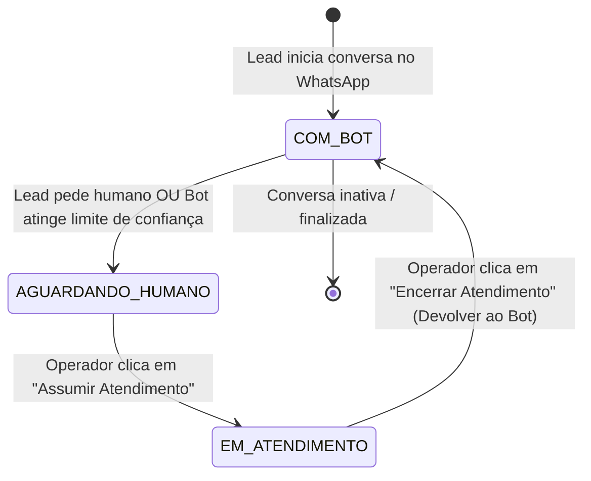

# [INIT-002] Caixa de Entrada Simplificada & Transbordo Humano

| Metadado | Detalhe |
| :--- | :--- |
| **ID da Iniciativa** | INIT-002 |
| **Branch Git** | `feature/INIT-002-caixa-de-entrada` |
| **Status** | 🚀 Aprovada (Core MVP) |
| **Responsável / Autor** | Equipe de Produto & Engenharia Núcleo3Pro |
| **Data de Criação** | 2026-11-10 |
| **Última Atualização** | 2026-11-10 |
| **Target Release / Marco** | MVP v1.0 |

---

## 1. 🎯 Visão Geral & Problema

### 1.1 Contexto
O principal valor de negócio do Núcleo3Pro no MVP é a capacidade de **transição suave (transbordo) entre a automação de IA/chatbot e o atendimento humano**. Quando um estudante ou candidato tem dúvidas complexas ou o bot não compreende a mensagem, um atendente precisa identificar a conversa imediatamente, assumi-la sem atritos e depois devolvê-la ao bot quando o atendimento for concluído.

### 1.2 Proposta de Valor
Uma interface central de caixa de entrada em 3 abas focadas em triagem de fila (`Com o Bot`, `Aguardando Humano`, `Em Atendimento`), com área de chat em tempo real e o controle de estado apelidado de **"Disjuntor"** (Assumir / Devolver ao Bot).

---

## 2. 📊 Objetivos & Métricas de Sucesso

- [ ] **Métrica 1:** Tempo de primeira resposta para conversas na aba `Aguardando Humano` menor que 2 minutos em horário comercial.
- [ ] **Métrica 2:** Zero mensagens do bot sobrepostas ou enviadas indevidamente enquanto um humano estiver com o atendimento assumido.
- [ ] **Métrica 3:** Menos de 3 cliques para um operador encontrar uma conversa, ler o histórico e assumir o atendimento.

---

## 3. 👥 Personas & Casos de Uso

| Persona | Cenário | Ação no Sistema |
| :--- | :--- | :--- |
| **Aluno / Lead** | "Quero falar com uma pessoa, não estou conseguindo pagar com o código" | O bot identifica a intenção e move a conversa para a fila de espera humana |
| **Atendente Comercial** | Monitora a fila de espera humana no painel web | Clica em "Assumir Atendimento", conversa com o lead e clica em "Encerrar Atendimento" |

---

## 4. 🧭 Escopo

### ✅ Dentro do Escopo (In-Scope)
- [ ] **Fila Única com 3 Abas (`Tabs`):**
  - `Com o Bot:` Conversas sob controle ativo da IA.
  - `Aguardando Humano:` Conversas que solicitaram transbordo ou tiveram falha de entendimento do bot.
  - `Em Atendimento:` Conversas assumidas por operadores humanos.
- [ ] **Interface de Mensageria:**
  - Lista de mensagens com diferenciação visual entre Aluno (esquerda), Bot (direita estilizada com tag "BOT") e Atendente Humano (direita estilizada com tag "HUMANO").
  - Campo de envio de texto rápido com suporte a `Enter`.
  - Pré-visualização de imagem e link/ícone para anexos em PDF.
- [ ] **Controle de Estado (O "Disjuntor"):**
  - Botão **"Assumir Atendimento"**: Altera o estado para `EM_ATENDIMENTO_HUMANO` e pausa o envio de respostas do bot.
  - Botão **"Encerrar Atendimento"**: Altera o estado de volta para `COM_BOT` e reativa a automação.

### ❌ Fora do Escopo (Out-of-Scope para o MVP)
- Distribuição automática de conversas (round-robin) entre operadores.
- Envio de áudios gravados no navegador ou gravação de voz.
- Menções (@atendente) internas em notas privadas.

---

## 5. 🏗️ Arquitetura de Alto Nível & Máquina de Estados

---

## 6. 📋 Quebra de Tarefas (Task Breakdown)

| Task ID | Título da Task | Responsável | Status | Link da Spec |
| :--- | :--- | :--- | :--- | :--- |
| `TASK-001` | Fila de Conversas em 3 Abas com Badges de Contagem | Dev / AI | 🚀 Pronta | [TASK-001.md](./tasks/TASK-001-fila-conversas-tabs.md) |
| `TASK-002` | Interface de Mensageria com Suporte a Mídia e Tempo Real | Dev / AI | 🚀 Pronta | [TASK-002.md](./tasks/TASK-002-interface-chat-mensageria.md) |
| `TASK-003` | Disjuntor de Transbordo (Assumir e Encerrar Atendimento) | Dev / AI | 🚀 Pronta | [TASK-003.md](./tasks/TASK-003-disjuntor-transbordo-bot-humano.md) |

---

## 7. 🔒 Segurança, Privacidade & Regras Operacionais

- [ ] Garantir que o clique em "Assumir Atendimento" seja atômico no backend para impedir que dois operadores assumam a mesma conversa simultaneamente.
- [ ] O número de telefone e mensagens do WhatsApp devem trafegar sobre HTTPS/WSS seguro.

---

## 8. 📝 Histórico de Decisões & Mudanças

| Data | Autor | Mudança / Decisão | Motivo |
| :--- | :--- | :--- | :--- |
| 2026-11-10 | Equipe Núcleo3Pro | Especificação do Core do MVP | Validação imediata da operação de transbordo |

