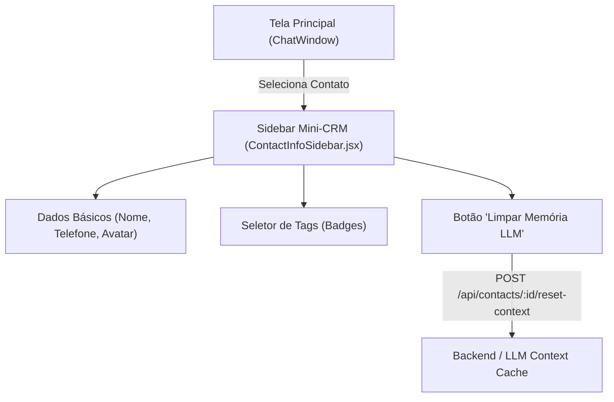

# [INIT-003] Contexto Mínimo do Contato (Mini-CRM & Tags)

| Metadado | Detalhe |
| :--- | :--- |
| **ID da Iniciativa** | INIT-003 |
| **Branch Git** | `feature/INIT-003-mini-crm` |
| **Status** | 🚀 Aprovada (Core MVP) |
| **Responsável / Autor** | Equipe de Produto & Engenharia Núcleo3Pro |
| **Data de Criação** | 2026-11-10 |
| **Última Atualização** | 2026-11-10 |
| **Target Release / Marco** | MVP v1.0 |

---

## 1. 🎯 Visão Geral & Problema

### 1.1 Contexto
Durante o atendimento de um estudante ou candidato, o atendente precisa saber instantaneamente com quem está falando (nome e telefone), em que estágio o contato se encontra (tags de categorização rápida) e dispor de uma ferramenta de contingência para destravar o bot caso o aluno tenha caído em algum loop de conversa no WhatsApp.

### 1.2 Proposta de Valor
Um painel lateral direito enxuto (Mini-CRM) que exibe a identificação básica do perfil do WhatsApp, um sistema de tags visuais com badges (`Dúvida Matrícula`, `Material Didático`, `Urgente`, etc.) e um botão de ação rápida para **Limpar Contexto / Resetar Memória do LLM**.

---

## 2. 📊 Objetivos & Métricas de Sucesso

- [ ] **Métrica 1:** Categorização de um contato com tags em menos de 2 cliques pelo atendente.
- [ ] **Métrica 2:** Capacidade de destravar 100% dos fluxos de teste ou de usuários presos resetando a memória da IA pelo botão dedicado.
- [ ] **Métrica 3:** Visualização limpa do perfil sem sobrecarregar a largura da tela principal do chat.

---

## 3. 👥 Personas & Casos de Uso

| Persona | Cenário | Ação no Sistema |
| :--- | :--- | :--- |
| **Atendente Comercial** | Identifica que o aluno tem pressa sobre edital prestes a encerrar | Clica na tag "Urgente" e "Edital 2026" para marcar visualmente o contato |
| **Desenvolvedor / Testador** | Testando variações de prompt do chatbot e precisa reiniciar o fluxo | Clica no botão "Limpar Contexto do Bot" para o número de teste |

---

## 4. 🧭 Escopo

### ✅ Dentro do Escopo (In-Scope)
- [ ] **Painel Lateral Direito (Mini-CRM):**
  - Card de identificação: Foto/Avatar, Nome (puxado do perfil do WhatsApp) e Número formatado com link direto para WhatsApp Web se necessário.
  - Data do primeiro contato e total de mensagens trocadas.
- [ ] **Sistema de Tags (Badges):**
  - Lista de tags pré-definidas no sistema (`Dúvida Matrícula`, `Material Didático`, `Pagamento Pendente`, `Urgente`).
  - Adição e remoção de tags com 1 clique.
- [ ] **Ação "Limpar Memória do LLM":**
  - Botão com diálogo de confirmação que limpa o histórico da sessão do agente de IA para aquele contato, permitindo que a próxima mensagem seja tratada como um novo início de conversa.

### ❌ Fora do Escopo (Out-of-Scope para o MVP)
- Histórico completo de compras de cursos ou notas fiscais integradas.
- Edição cadastral avançada (CPF, endereço, data de nascimento).
- Criação dinâmica de tags customizadas com paletas de cores livres pelo usuário (usaremos tags pré-configuradas no MVP).

---

## 5. 🏗️ Arquitetura de Alto Nível & Componentes

---

## 6. 📋 Quebra de Tarefas (Task Breakdown)

| Task ID | Título da Task | Responsável | Status | Link da Spec |
| :--- | :--- | :--- | :--- | :--- |
| `TASK-001` | Painel Lateral de Contato com Dados Básicos | Dev / AI | 🚀 Pronta | [TASK-001.md](./tasks/TASK-001-painel-lateral-contato.md) |
| `TASK-002` | Sistema de Tags Visuais com Badges Rápidos | Dev / AI | 🚀 Pronta | [TASK-002.md](./tasks/TASK-002-sistema-tags-badges.md) |
| `TASK-003` | Botão e Ação de Limpar Contexto do LLM | Dev / AI | 🚀 Pronta | [TASK-003.md](./tasks/TASK-003-acao-limpar-memoria-llm.md) |

---

## 7. 🔒 Segurança, Privacidade & LGPD

- [ ] A limpeza de memória do LLM afeta o histórico de conversação do modelo cognitivo, mas preserva a transcrição do chat para fins de auditoria no painel.

---

## 8. 📝 Histórico de Decisões & Mudanças

| Data | Autor | Mudança / Decisão | Motivo |
| :--- | :--- | :--- | :--- |
| 2026-11-10 | Equipe Núcleo3Pro | Criação da spec para o Mini-CRM MVP | Dar contexto ágil ao atendente humano e controle de testes |

