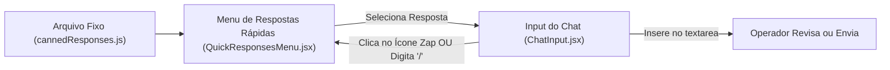

# [INIT-004] Aceleradores de Rotina & Respostas Rápidas (Canned Responses)

| Metadado | Detalhe |
| :--- | :--- |
| **ID da Iniciativa** | INIT-004 |
| **Branch Git** | `feature/INIT-004-respostas-rapidas` |
| **Status** | 🚀 Aprovada (Core MVP) |
| **Responsável / Autor** | Equipe de Produto & Engenharia Núcleo3Pro |
| **Data de Criação** | 2026-11-10 |
| **Última Atualização** | 2026-11-10 |
| **Target Release / Marco** | MVP v1.0 |

---

## 1. 🎯 Visão Geral & Problema

### 1.1 Contexto
Durante o atendimento humano, muitas dúvidas de alunos se repetem diariamente (link de editais vigentes, calendário de aulas, opções de parcelamento e chave PIX para matrícula imediata). Digitar manualmente essas mensagens repetidamente reduz a velocidade e gera inconsistência nas orientações.

### 1.2 Proposta de Valor
Disponibilizar um componente de **Respostas Rápidas (Canned Responses)** integrado diretamente à barra de digitação do chat, acessível por um botão dedicado de raio (`Zap`) ou atalho de teclado (`/`), permitindo preencher ou enviar respostas padronizadas em 1 clique.

---

## 2. 📊 Objetivos & Métricas de Sucesso

- [ ] **Métrica 1:** Redução de 50% no tempo necessário para enviar informações padronizadas (PIX, Editais, Horários).
- [ ] **Métrica 2:** Erro zero de digitação de chave PIX ou links de editais oficiais.
- [ ] **Métrica 3:** Menos de 2 segundos para o atendente selecionar e enviar uma resposta pronta.

---

## 3. 👥 Personas & Casos de Uso

| Persona | Cenário | Ação no Sistema |
| :--- | :--- | :--- |
| **Atendente Comercial** | Aluno pede a chave PIX para efetuar a matrícula com desconto | Digita `/pix` ou clica no ícone de respostas rápidas e seleciona o template do PIX |
| **Secretaria Acadêmica** | Aluno pergunta onde baixar o edital oficial | Seleciona o template "Link do Edital Completo" e envia com 1 clique |

---

## 4. 🧭 Escopo

### ✅ Dentro do Escopo (In-Scope)
- [ ] Arquivo de configuração local de respostas rápidas (`src/config/cannedResponses.js`) com categorias:
  - 💳 **Pagamento:** Chave PIX e dados bancários institucionais.
  - 📄 **Editais:** Links e prazos dos editais abertos.
  - ⏰ **Turmas:** Horários e início das próximas turmas.
  - 👋 **Saudação & Encerramento:** Mensagens padronizadas de início e fim de atendimento humano.
- [ ] Menu suspenso (Dropdown/Popover) integrado ao lado do input de texto do chat.
- [ ] Capacidade de inserir o texto no campo de digitação (para que o operador possa editar antes de enviar) OU enviar diretamente.

### ❌ Fora do Escopo (Out-of-Scope para o MVP)
- Interface administrativa no painel para criar/editar novas respostas rápidas no banco de dados (ficará para a V2).
- Tags variáveis automáticas complexas (ex: `{lead.valor_calculado_com_juros}`).

---

## 5. 🏗️ Arquitetura de Alto Nível & Fluxos

---

## 6. 📋 Quebra de Tarefas (Task Breakdown)

| Task ID | Título da Task | Responsável | Status | Link da Spec |
| :--- | :--- | :--- | :--- | :--- |
| `TASK-001` | Catálogo de Respostas Prontas e Menu Dropdown | Dev / AI | 🚀 Pronta | [TASK-001.md](./tasks/TASK-001-menu-canned-responses.md) |
| `TASK-002` | Integração com Input do Chat e Atalho Rápido | Dev / AI | 🚀 Pronta | [TASK-002.md](./tasks/TASK-002-atalhos-e-insercao-chat.md) |

---

## 7. 🔒 Segurança, Privacidade & LGPD

- [ ] Dados bancários e de PIX fixados no template devem ser validados pela diretoria financeira do Núcleo3Pro antes de ir a produção.

---

## 8. 📝 Histórico de Decisões & Mudanças

| Data | Autor | Mudança / Decisão | Motivo |
| :--- | :--- | :--- | :--- |
| 2026-11-10 | Equipe Núcleo3Pro | Criação da spec para o MVP v1.0 | Acelerar a produtividade do atendimento humano inicial |

