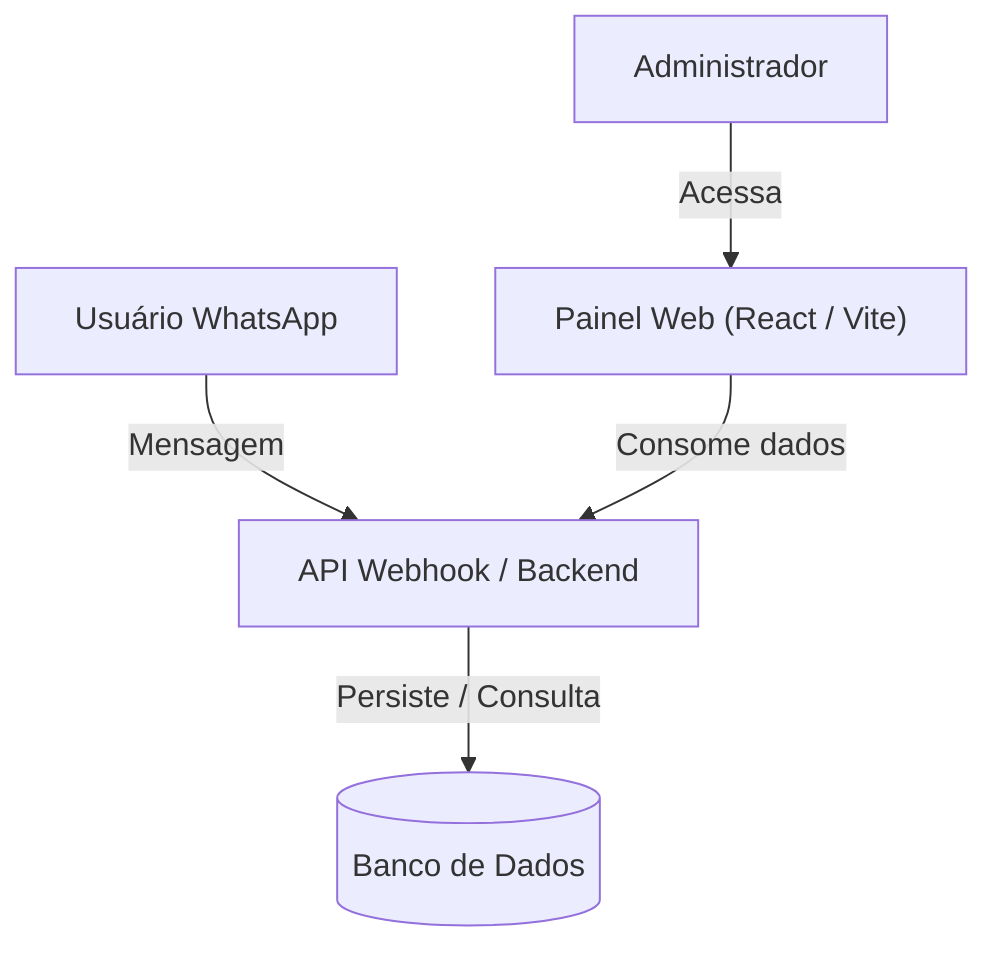

# [INIT-XXX] Título da Iniciativa

| Metadado | Detalhe |
| :--- | :--- |
| **ID da Iniciativa** | INIT-XXX |
| **Branch Git** | `feature/INIT-XXX-nome-da-iniciativa` |
| **Status** | 📝 Rascunho \| 🚀 Aprovada \| ⚙️ Em Progresso \| ✅ Concluída |
| **Responsável / Autor** | Nome do Autor / Dev |
| **Data de Criação** | AAAA-MM-DD |
| **Última Atualização** | AAAA-MM-DD |
| **Target Release / Marco** | Ex: MVP v1.0, Sprint 3, etc. |

---

## 1. 🎯 Visão Geral & Problema

### 1.1 Contexto
> Descreva o cenário atual. Por que esta iniciativa existe? Qual é a dor do usuário, do cliente ou do negócio?

### 1.2 Proposta de Valor
> O que estamos construindo e qual é o impacto esperado após a entrega?

---

## 2. 📊 Objetivos & Métricas de Sucesso

- [ ] **Métrica 1:** Ex: Reduzir tempo de resposta do lead no WhatsApp em 70%.
- [ ] **Métrica 2:** Ex: Aumentar a taxa de conversão de leads em matrículas para 15%.
- [ ] **Métrica 3:** Ex: Disponibilizar exportação de relatórios em menos de 2 segundos.

---

## 3. 👥 Personas & Casos de Uso

| Persona | Necessidade | Benefício Esperado |
| :--- | :--- | :--- |
| **Aluno / Lead** | Tirar dúvidas de cursos e obter link de pagamento | Atendimento instantâneo 24/7 via WhatsApp |
| **Administrador** | Filtrar leads por curso e acompanhar status de conversão | Visão centralizada das vendas e performance |

---

## 4. 🧭 Escopo

### ✅ Dentro do Escopo (In-Scope)
- [ ] Funcionalidade A (ex: Fluxo de captura de dados básicos do lead no chat).
- [ ] Funcionalidade B (ex: Tela de listagem com filtros no painel web).
- [ ] Funcionalidade C (ex: Notificação de pagamento confirmado).

### ❌ Fora do Escopo (Out-of-Scope)
> Importante para evitar escopo inflado (scope creep) durante a execução com a IA.
- Ex: Envio de anexos em áudio pelo chatbot (ficará para a versão 2.0).
- Ex: Módulo avançado de emissão de certificados automáticos.

---

## 5. 🏗️ Arquitetura de Alto Nível & Fluxos

### Principais Dependências & Integrações:
- **APIs Externas:** (ex: Meta Cloud API WhatsApp, Stripe / Asaas / Mercado Pago)
- **Serviços Internos:** (ex: Autenticação, banco de dados, storage)

---

## 6. 📋 Quebra de Tarefas (Task Breakdown)

As tarefas detalhadas devem ser descritas em arquivos individuais na pasta `tasks/`.

| Task ID | Título da Task | Responsável | Status | Link da Spec |
| :--- | :--- | :--- | :--- | :--- |
| `TASK-001` | Modelagem de dados e schema de Leads | Dev Name | 🚀 Pronta | [TASK-001.md](./tasks/TASK-001.md) |
| `TASK-002` | Criação de endpoint / mock de listagem com filtros | Dev Name | 📝 Rascunho | [TASK-002.md](./tasks/TASK-002.md) |
| `TASK-003` | Interface da Tabela de Leads no Painel Web | Dev Name | 📝 Rascunho | [TASK-003.md](./tasks/TASK-003.md) |

---

## 7. 🔒 Segurança, Privacidade & LGPD

- [ ] **Dados Sensíveis:** Há tratamento de CPF, telefone ou dados financeiros?
- [ ] **Políticas de Acesso:** Quais papéis de usuário podem acessar ou editar essas informações?
- [ ] **Armazenamento de Tokens:** Como chaves de API e segredos são gerenciados? (Variáveis de ambiente `.env`).

---

## 8. 📝 Histórico de Decisões & Mudanças

| Data | Autor | Mudança / Decisão | Motivo |
| :--- | :--- | :--- | :--- |
| AAAA-MM-DD | Nome | Criação da spec inicial | Início do projeto |

